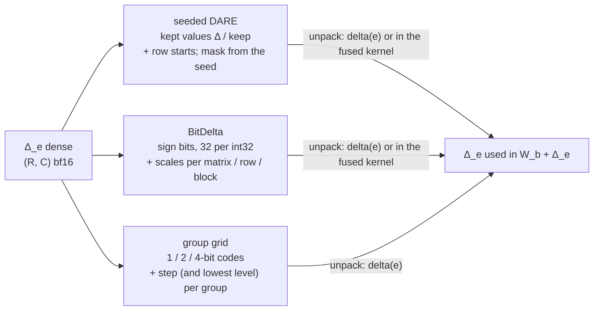

# Delta formats

A $\Delta_e$ is stored dense by default (`DeltaMoE`), or compressed; the base $W_b$ is always dense. The compressed forms take a `DeltaMoE` (`from_delta_moe`) and keep its base, router, top-k and zero experts; group grids also take a `HierDeltaMoE`.



See [dare.md](dare.md), [bitdelta.md](bitdelta.md) and [grid.md](grid.md). [delta-compression.md](delta-compression.md) compares these with other compressions (low-bit quantisation, GPTQ, SparseGPT, Wanda, SVD, ...) on a real model: 2-bit group quantisation keeps the accuracy at 2.25 bits per entry.


Size of one delta of a Qwen3.5-4B MoE layer (hidden 2560, inter 9216) takes:

| Format | Size |
|---|---:|
| dense bf16 | 141.6 MB |
| seeded DARE 0.2, block 64 | 28.3 MB of kept values, plus a 0.7 MB bitmap per layer |
| BitDelta | 8.85 MB of sign bits, plus 42 KB of row scales |
| group grid, 2 bit, group 128 | 17.7 MB of codes, plus 2.2 MB of steps and lowest levels |


```{toctree}
:maxdepth: 1

dare
bitdelta
grid
delta-compression
```
