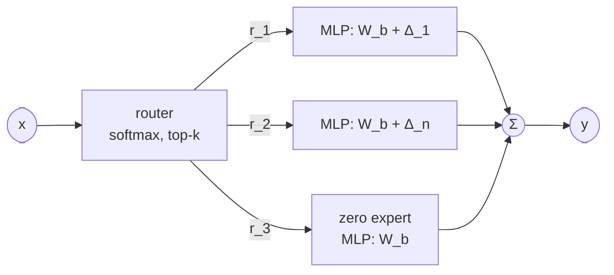
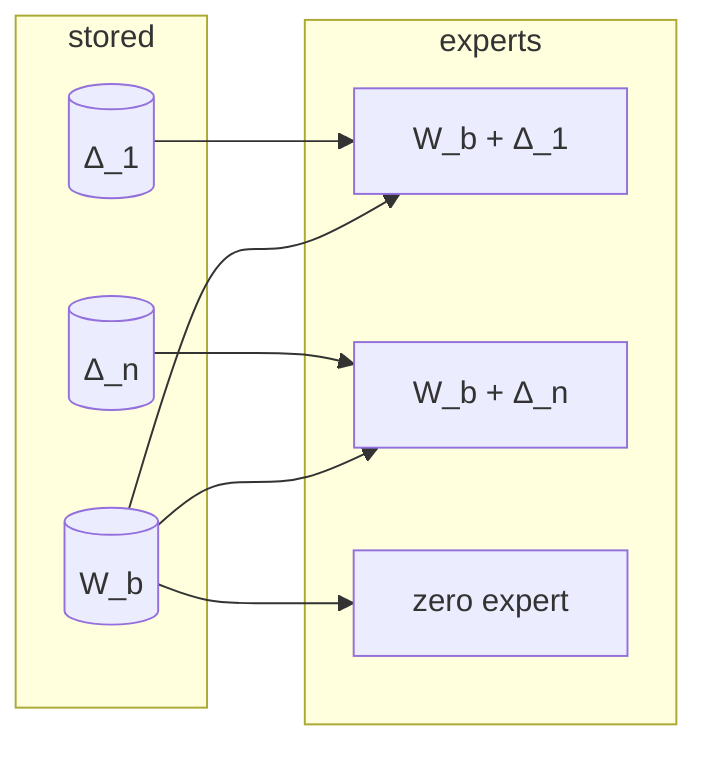

# DeltaMoE

Each routed expert's weights are $W_e = W_b + \Delta_e$, applied to gate, up and down separately. The router's first n rows are the deltas; its last `num_zero_experts` rows (Z, default 1) are **zero experts**: they have no parameters and each stands for the base MLP itself. Whatever Z is, base + n deltas has exactly as many parameters as the original MoE's n+1 distinct experts. With Z = 0 the base is only a shared component, never chosen on its own; with Z > 1 the original MoE is equivalent to one with Z copies of the base expert (which gives the router more room to send tokens to the base).

Routing is softmax, top-k (`top_k`, default 1), renormalised over the k picks to weights $r_i$. The target is the original MoE:

$$y = \sum_{i=1}^{k} r_i\,\mathrm{MLP}(x;\,W_b + \Delta_{e_i})$$

**Storage.** The diagram above is the computation. What a layer stores is $W_b$ once and one $\Delta_e$ per delta
expert; a zero expert stores nothing but its router row. State dict of one layer (Qwen3.5 checkpoints: under
`model.layers.{l}.mlp.`), $n$ deltas, $Z$ zero experts:

| key | shape | holds |
|---|---|---|
| `gate`, `up`, `down` | $(I, H)$, $(I, H)$, $(H, I)$ | $W_b$, once |
| `d_gate`, `d_up`, `d_down` | $(n, I, H)$, $(n, I, H)$, $(n, H, I)$ | $\Delta_1, \ldots, \Delta_n$ |
| `router.weight` | $(n+Z,\ H)$ | rows $0..n-1$ route to the deltas, rows $n..n+Z-1$ to the base |

- **Size.** $(1+n)$ MLPs of weights plus the router: the original MoE's $n+1$ experts, whatever $Z$ is.
- **From a Qwen3.5 MoE** (`qwen3_5_delta_moe.convert`): the chosen base expert's weights become $W_b$, every other
  expert $e$ becomes $\Delta_e = W_e - W_b$ in the checkpoint dtype, and the base's router row moves to the end
  (row $n$, the zero expert, $Z=1$). The shared expert is dropped (the converter asserts its output is zero).
- **Not stored.** $Z$ and top-k are in the config (`delta_moe_zero_experts`, `num_experts_per_tok`; `num_experts` =
  $n+Z$).
- **Compressed deltas** replace `d_<proj>` with their own buffers: [Delta formats](delta-formats.md).

The forwards that compute it are in [Forward dispatch](../internals/dispatch.md); compressed deltas in
[Delta formats](delta-formats.md).

Note two things that would not be equivalent:

- **Adding whole-MLP outputs.** SwiGLU is nonlinear in its weights, so $\mathrm{MLP}(x;W_b) + \mathrm{MLP}(x;\Delta_e) \ne \mathrm{MLP}(x;W_b+\Delta_e)$. The addition has to happen on each weight matrix.
- **Merging into one activation when $k>1$.** Adding every slot's $r_i\Delta_{e_i}x$ into a single activation amounts to merging weights per token, $\mathrm{MLP}(x;\,W_b+\sum_i r_i\Delta_{e_i})$. That is a different function from the MoE above. So in per-matrix output aggregation each slot keeps its own activation; only $W_b x$ in gate/up is shared across slots. Down needs $k$ passes.

With $k=1$, $r=1$ and both forms reduce to one MLP. Under top-k the zero expert can be one of the k picks: its share $r_i$ goes to the base MLP.

Build one from a plain MoE with `DeltaMoE.from_experts(base, experts, router, top_k)`:

- `base`: the base expert's `(gate (I, H), up (I, H), down (H, I))`.
- `experts`: the other n experts' full weights $W_e$ (not deltas), each in the same `(gate, up, down)` form; $\Delta_e = W_e - W_b$ is computed inside.
- `router`: the original router weight `(n+Z, H)`, with rows n..n+Z-1 routing to the base (if the base is expert 0 in the original MoE, move its row to the end first).
- `num_zero_experts`: Z, default 1.

The other way, `m.to_moe()` gives the plain MoE (`shared_delta_moe.MoE`): $N+Z$ full experts
$[W_b+\Delta_1, \dots, W_b+\Delta_N] + [W_b]\times Z$ in `gate`/`up` `(E, I, H)` and `down` `(E, H, I)`, the same
router and top-k, so it computes the same function (it is the baseline in the tests and benchmarks). Build one directly
with `MoE.from_experts(experts, router, top_k)`; its forward is one `F.grouped_mm` per projection or a loop over the
routed experts, both differentiable.

transformers' fused layout maps over as `gate, up = gate_up_proj[e].chunk(2)` and `down = down_proj[e]`. In bf16, $W_b + (W_e - W_b)$ is not always exactly $W_e$ (about 0.6% of elements in our model).

Apart from the Triton kernels, everything is `F.linear` (cuBLAS), `F.grouped_mm` (PyTorch's own grouped GEMM: CUDA sm80+ or CPU, bf16/fp16/fp32) and `index_add`. bf16/fp16 are the targets; fp32 is supported (and used for the CPU tests), fp64 is not.
