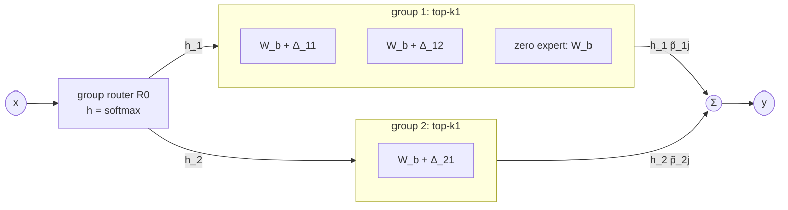
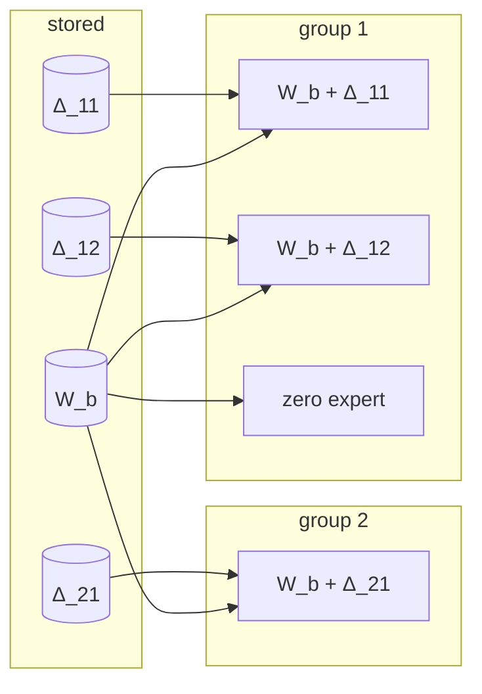

# HierDeltaMoE (two-level routing)

Delta experts arranged in groups over one shared base $W_b$, routed first over groups and then within the chosen
groups (`models/hier.py`). Group $i$ holds $E_i$ delta experts with weights $W_b+\Delta_{ij}$ and $Z_i$ zero experts
(no parameters, $\Delta=0$: the base MLP itself, as in `DeltaMoE`); $E_i$ and $Z_i$ may differ between groups, and a
group may hold only zero experts. "Shared" is the storage: $W_b$ once per layer, one $\Delta_{ij}$ per delta expert.

- Group router: $h = \mathrm{softmax}(R_0 x)$ over the $G$ groups; dense / soft (`group_top_k=None`: every group,
  weight $h_i$) or top-$k_0$ renormalised over the chosen groups.
- Within group $i$: softmax over its $E_i+Z_i$ logits, top-$k_1$ (`top_k`), renormalised within the group; zero
  experts compete like the others.

$$
y = \sum_{i \in S(x)} h_i(x) \sum_{j \in \text{top-}k_1} \tilde p_{ij}(x)\, \mathrm{MLP}(x; W_b+\Delta_{ij}),
\qquad \Delta_{ij}=0 \text{ for a zero expert}
$$

The weights sum to 1, so $y$ is the plain two-level ensemble of the full experts $\theta_{ij}=W_b+\Delta_{ij}$
($\theta=W_b$ for a zero expert), on the scale of the original MLP. One linear layer holds both routers: rows
$0..G-1$ are $R_0$, then group by group its $E_i$ delta rows and $Z_i$ zero-expert rows.



**Storage.** The diagram above is the computation: every routed expert runs as $W_b+\Delta_{ij}$. What a layer stores
is one base and one delta per delta expert, all groups in one stack; a zero expert stores nothing but its router row.
State dict of one layer (Qwen3.5 checkpoints: under `model.layers.{l}.mlp.`), $N=\sum_i E_i$:

| key | shape | holds |
|---|---|---|
| `gate`, `up`, `down` | $(I, H)$, $(I, H)$, $(H, I)$ | $W_b$, once |
| `d_gate`, `d_up`, `d_down` | $(N, I, H)$, $(N, I, H)$, $(N, H, I)$ | $\Delta_{ij}$, group 1's $E_1$ deltas, then group 2's, ... |
| `router.weight` | $(G+\sum_i(E_i+Z_i),\ H)$ | $R_0$ ($G$ rows), then per group its $E_i$ delta rows and $Z_i$ zero-expert rows |




- **Size.** $(1+N)$ MLPs of weights plus the router: the same as the $N$ full experts and the base stored separately;
  a zero expert costs one router row. In bf16 at hidden 2560, inter 9216, $W_b$ and each $\Delta_{ij}$ are 141.6 MB.
- **Dtype.** The deltas are in the model dtype; the converter subtracts in fp32 and rounds once
  ($\Delta_{ij}=\theta_{ij}-W_b$), so $W_b+\Delta_{ij}$ may differ from $\theta_{ij}$ in the last bit.
- **Not stored.** Group sizes and zero counts are in the config (`hier_delta_moe`: `group_sizes`, `group_zeros`,
  `top_k`, `group_top_k`); the tables that map a group's experts to router columns and delta indices are built from
  them on first use.
- Deltas are dense only: DARE and BitDelta (`PackedDeltaMoE`) take flat `DeltaMoE`s.

**Usage.**

```python
import torch
from shared_delta_moe import HierDeltaMoE, random_experts

H, I = 1024, 4096
full = random_experts(H, I, 6, torch.bfloat16, "cuda")    # (gate, up, down) each
base, groups = full[0], [full[1:3], full[3:4], full[4:6]]  # E = 2, 1, 2 experts per group
zeros = [1, 0, 0]                                         # Z: one zero expert in group 0
router = torch.randn(3 + sum(len(g) + z for g, z in zip(groups, zeros)), H, dtype=torch.bfloat16, device="cuda") * H**-0.5
moe = HierDeltaMoE.from_experts(base, groups, router, zeros, top_k=1, group_top_k=None)

x = torch.randn(32, H, dtype=torch.bfloat16, device="cuda")
y = moe.forward_param(x)  # the fused Triton kernel on CUDA; differentiable (Triton backward with triton_train)
```

`from_experts` takes the full experts $\theta_{ij}$ and stores $\Delta_{ij}=\theta_{ij}-W_b$. To start from shapes
instead, use `HierDeltaMoE(hidden, inter, group_sizes, group_zeros, top_k, group_top_k)` and load
`gate`/`up`/`down`, `d_gate`/`d_up`/`d_down` and `router.weight`.

`moe.to_moe()` gives the same two-level MoE with full experts stored (`HierMoE`): [Plain MoE](moe.md).

**Implementation.** `topk` flattens the routing into ordinary `DeltaMoE` slots: per token $S\cdot k_1$ slots
($S=G$ dense, else $k_0$) weighted $h_i\tilde p_{ij}$; a picked zero expert is a base slot. Every `DeltaMoE` forward (materialised, split, grouped, fused Triton) and the Triton training path
([training.md](training.md)) then compute $y$ unchanged, gradients through the two softmaxes included.

**Limits.** Zero experts picked in several groups each take a base slot, so the base MLP may run more than once per
token (the slots are not merged). Dense deltas only: `DareDeltaMoE.from_delta_moe` and `BitDeltaMoE.from_delta_moe`
refuse a `HierDeltaMoE`. The routing tables are built per device on first use (not buffers), so modules made on the meta device,
as transformers' `from_pretrained` does, work. `tests/test_hier.py` checks every forward and the gradients against the ensemble
written out token by token.

Building one per layer from a dense model and its fine-tunes: [Converting Qwen3.5 models](qwen3_5.md); serving
the result: [Serving with vLLM](vllm.md).
