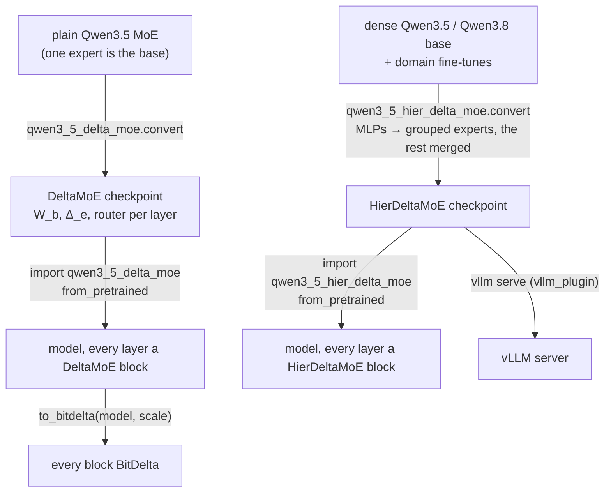

# Converting Qwen3.5 models

`modeling.py` defines one MLP block; importing the package patches transformers' decoder layer, so that
`from_pretrained` builds that block in **every** layer whose text config has the block's field. Converting a whole model
is two steps: convert the checkpoint once, then import and load it. Which converter depends on what you start from.



Both converters stream: they read one MLP (or tensor) at a time and write shards of `--shard-gb` (default 5) with an
index, so memory stays at about one layer. The shared I/O and the decoder-layer patch are in
`models/qwen3_5/common.py`.

## From a plain MoE: DeltaMoE

```bash
python -m shared_delta_moe.models.qwen3_5.qwen3_5_delta_moe.convert PLAIN_MOE OUT [--base INDEX] [--top-k K]
```

```python
import shared_delta_moe.models.qwen3_5.qwen3_5_delta_moe  # patches Qwen3_5MoeDecoderLayer
model = AutoModelForImageTextToText.from_pretrained(OUT, num_experts_per_tok=2)  # or AutoModelForCausalLM
```

The plain MoE's expert BASE becomes $W_b$ and the zero expert; the others become $\Delta_e$. BASE defaults to the
expert named `"base"` in `PLAIN_MOE/upscale_info.json`. Its shared expert must have no output (it is dropped).
`num_experts_per_tok` is the top-k at load time (= `num_experts` for soft routing over all experts).

`to_bitdelta(model, scale="matrix")` replaces every DeltaMoE block of a loaded model with its BitDelta form
([bitdelta.md](bitdelta.md)), in place:

```python
from shared_delta_moe.models.qwen3_5.qwen3_5_delta_moe import to_bitdelta
model = to_bitdelta(AutoModelForImageTextToText.from_pretrained(OUT), scale="row")
```

`convert_state(state_dict, base)` converts a state dict already in memory, every layer at once.

## From a dense base and its fine-tunes: HierDeltaMoE

```bash
python -m shared_delta_moe.models.qwen3_5.qwen3_5_hier_delta_moe.convert BASE DST \
    --group medical=FT1,FT2 --group code=FT3 [--zeros 0] [--top-k 1] [--group-top-k K] \
    [--merge simple_average | task_arithmetic | ties_merging] [--merge-arg scaling_factor=0.3 --merge-arg threshold=20]
```

```python
import shared_delta_moe.models.qwen3_5.qwen3_5_hier_delta_moe  # patches Qwen3_5DecoderLayer
model = Qwen3_5ForConditionalGeneration.from_pretrained(DST)  # or Qwen3_5ForCausalLM for a text-only checkpoint
```

One group per domain; each fine-tune's decoder MLP becomes an expert of its group ($\Delta_{ij}=\theta_{ij}-W_b$,
subtracted in fp32), `BASE`'s MLP is $W_b$. Every other tensor (attention, linear attention, norms, embeddings,
`lm_head`, vision tower, MTP) is merged across the fine-tunes that have it with a method of `merging.py` (a
tensor no fine-tune has, like Qwen3.8's `mtp.*` that transformers drops on load, is kept from the base). The methods
call fusion_bench (install the `merging` extra: `pip install -e ".[transformers,merging]"`), with its names and
arguments (`simple_average` default; TIES trims per tensor, not over the whole task vector). Routers start at
zero (uniform), to be trained. The text config gets `hier_delta_moe` (groups, sizes, zeros, top-k,
merge). Tensors are streamed from the safetensors shards and written in shards (`--shard-gb`), so memory stays at a
few tensors. `tests/test_qwen3_5_hier_delta_moe.py` converts a tiny model with perturbed fine-tunes and compares its
logits with the stock dense model running the ensemble of the fine-tunes' full MLPs.

