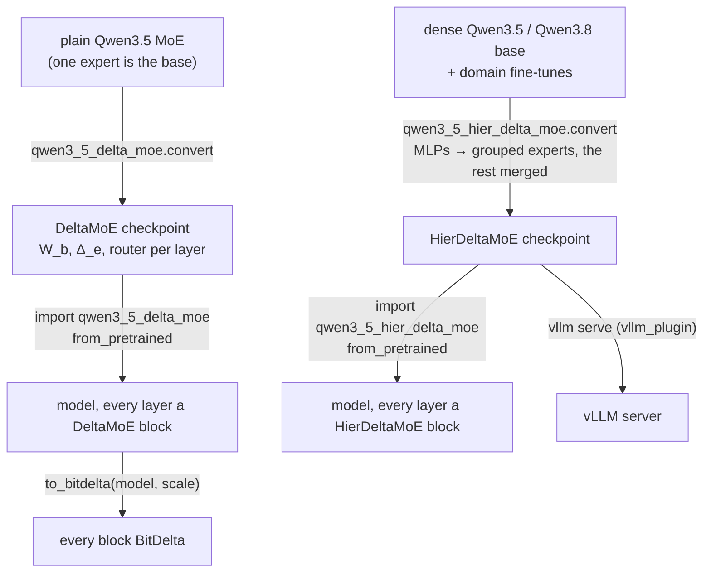

# Converting Qwen3.5 models

`modeling.py` defines one MLP block; importing the package patches transformers' decoder layer, so that
`from_pretrained` builds that block in **every** layer whose text config has the block's field. Converting a whole model
is two steps: convert the checkpoint once, then import and load it. Which converter depends on what you start from.



Both converters stream: they read one MLP (or tensor) at a time and write shards of `--shard-gb` (default 5) with an
index, so memory stays at about one layer. The shared I/O and the decoder-layer patch are in
`models/qwen3_5/common.py`.

## From a plain MoE: DeltaMoE

```bash
python -m shared_delta_moe.models.qwen3_5.qwen3_5_delta_moe.convert PLAIN_MOE OUT [--base INDEX] [--top-k K]
```

```python
import shared_delta_moe.models.qwen3_5.qwen3_5_delta_moe  # patches Qwen3_5MoeDecoderLayer
model = AutoModelForImageTextToText.from_pretrained(OUT, num_experts_per_tok=2)  # or AutoModelForCausalLM
```

The plain MoE's expert BASE becomes $W_b$ and the zero expert; the others become $\Delta_e$. BASE defaults to the
expert named `"base"` in `PLAIN_MOE/upscale_info.json`. Its shared expert must have no output (it is dropped).
`num_experts_per_tok` is the top-k at load time (= `num_experts` for soft routing over all experts).

`to_bitdelta(model, scale="matrix")` replaces every DeltaMoE block of a loaded model with its BitDelta form
([bitdelta.md](bitdelta.md)), in place:

```python
from shared_delta_moe.models.qwen3_5.qwen3_5_delta_moe import to_bitdelta
model = to_bitdelta(AutoModelForImageTextToText.from_pretrained(OUT), scale="row")
```

`convert_state(state_dict, base)` converts a state dict already in memory, every layer at once.

## From a dense base and its fine-tunes: HierDeltaMoE

```bash
python -m shared_delta_moe.models.qwen3_5.qwen3_5_hier_delta_moe.convert BASE DST \
    --group medical=FT1,FT2 --group code=FT3 [--zeros 0] [--top-k 1] [--group-top-k K] \
    [--merge simple_average | task_arithmetic | ties_merging] [--merge-arg scaling_factor=0.3 --merge-arg threshold=20]
```

```python
import shared_delta_moe.models.qwen3_5.qwen3_5_hier_delta_moe  # patches Qwen3_5DecoderLayer
model = Qwen3_5ForConditionalGeneration.from_pretrained(DST)  # or Qwen3_5ForCausalLM for a text-only checkpoint
```

One group per domain; each fine-tune's decoder MLP becomes an expert of its group ($\Delta_{ij}=\theta_{ij}-W_b$,
subtracted in fp32), `BASE`'s MLP is $W_b$. Every other tensor (attention, linear attention, norms, embeddings,
`lm_head`, vision tower, MTP) is merged across the fine-tunes that have it with a method of `merging.py` (a
tensor no fine-tune has, like Qwen3.8's `mtp.*` that transformers drops on load, is kept from the base). The methods
call fusion_bench (install the `merging` extra: `pip install -e ".[transformers,merging]"`), with its names and
arguments (`simple_average` default; TIES trims per tensor, not over the whole task vector). Routers start at
zero (uniform), to be trained. The text config gets `hier_delta_moe` (groups, sizes, zeros, top-k,
merge). Tensors are streamed from the safetensors shards and written in shards (`--shard-gb`), so memory stays at a
few tensors. `tests/test_qwen3_5_hier_delta_moe.py` converts a tiny model with perturbed fine-tunes and compares its
logits with the stock dense model running the ensemble of the fine-tunes' full MLPs.


### Per-expert attention and `lm_head` deltas

Full fine-tunes (continued pretraining) change every weight, and a merged attention loses much of what they learned:
on three Qwen3.8-27B experts, a shared attention, linear attention and `lm_head` (mean, task arithmetic or TIES) is
7-12 times further from each expert than giving each expert its own 2-bit delta
([delta compression](delta-compression.md)). `--routed-deltas` keeps them per expert:

```bash
python -m shared_delta_moe.models.qwen3_5.qwen3_5_hier_delta_moe.convert BASE DST --group ... \
    --routed-deltas [--routed-levels 4 --routed-group 128 [--routed-symmetric]] [--routed-sets 4,4,4,2] \
    [--levels 4 --grid-group 128 [--symmetric]]
```

Every attention projection (`q_proj`, `k_proj`, `v_proj`, `o_proj`), linear-attention projection (`in_proj_qkv`,
`in_proj_z`, `in_proj_b`, `in_proj_a`, `out_proj`) and `lm_head` becomes a `RoutedDeltaLinear`
(`models/routed_linear.py`): the base weight $W_b$ plus each expert's $\Delta_e$, dense or on a group grid
([group grids](grid.md); `--routed-levels` rounds to nearest, no data). Token $t$ with routing slots $(e_i, r_i)$,
$\sum_i r_i = 1$, gets

$$
y_t = W_b x_t + \sum_i r_i \, \Delta_{e_i} x_t = \Big(W_b + \sum_i r_i \Delta_{e_i}\Big) x_t ,
$$

the routed experts' weights mixed per token; the layer is linear, so mixing outputs and mixing weights agree. A zero
expert adds no delta. Each attention block has its own router `delta_router`, shaped like its layer's MoE router and
routed the same way (`DeltaMoE.topk(x, router)`: groups, zero experts and top-k as in the MLP), on the block's input;
`lm_head`'s router is routed like the last layer's MoE. Expert $e$ is the same fine-tune in every routed weight. The
routers start at zero, like the MLP's.

Embeddings, norms and the linear attention's `conv1d`, `A_log` and `dt_bias` stay shared (`--merge`; the base itself
with `--merge task_arithmetic --merge-arg scaling_factor=0`): on the 27B experts sharing them costs little, sharing
`lm_head` does not. The text config gets `routed_deltas` (`levels`, null for dense; `group`; `symmetric`; `sets`),
which both Qwen3.5 integrations read.

`--routed-sets` gives consecutive experts (in expert order) one routed delta, the mean of theirs, e.g. one per data
domain when each domain has several fine-tunes: $S$ sets store $S$ deltas instead of $N$. A token's routing weight on
a set is the sum of its slots' weights on the set's experts,

$$
y_t = W_b x_t + \sum_i r_i \, \bar\Delta_{s(e_i)} x_t ,
$$

with $s(e)$ the set of expert $e$ and $\bar\Delta_s$ its mean delta.

`--levels` stores the MLP deltas as group grids too (round to nearest, [group grids](grid.md)); the config's
`hier_delta_moe` gets `levels`, `group`, `symmetric`, and the model builds `Qwen3_5GridHierDeltaMoeBlock`
(a `GridHierDeltaMoE`; no fused kernel reads the codes yet, every forward is the materialised one). The forward loops over the routed experts (no fused kernel yet).
`tests/test_routed_linear.py` checks the layer against per-token weight mixing, and a converted tiny model routed to
one expert against that fine-tune.
