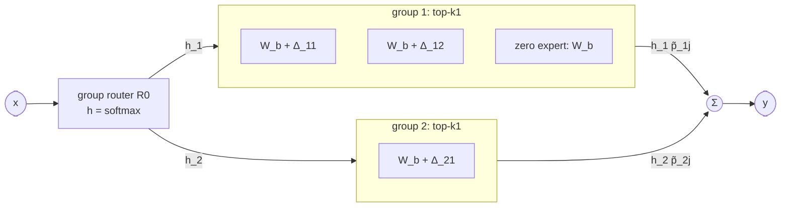

# Two-level shared delta MoE (`HierDeltaMoE`)

Delta experts arranged in groups over one shared base $W_b$, routed first over groups and then within the chosen
groups (`models/hier.py`). Group $i$ holds $E_i$ delta experts with weights $W_b+\Delta_{ij}$ and $Z_i$ zero experts
(no parameters, $\Delta=0$: the base MLP itself, as in `DeltaMoE`); $E_i$ and $Z_i$ may differ between groups, and a
group may hold only zero experts. "Shared" is the storage: $W_b$ once per layer, one $\Delta_{ij}$ per delta expert.

- Group router: $h = \mathrm{softmax}(R_0 x)$ over the $G$ groups; dense / soft (`group_top_k=None`: every group,
  weight $h_i$) or top-$k_0$ renormalised over the chosen groups.
- Within group $i$: softmax over its $E_i+Z_i$ logits, top-$k_1$ (`top_k`), renormalised within the group; zero
  experts compete like the others.

$$
y = \sum_{i \in S(x)} h_i(x) \sum_{j \in \text{top-}k_1} \tilde p_{ij}(x)\, \mathrm{MLP}(x; W_b+\Delta_{ij}),
\qquad \Delta_{ij}=0 \text{ for a zero expert}
$$

The weights sum to 1, so $y$ is the plain two-level ensemble of the full experts $\theta_{ij}=W_b+\Delta_{ij}$
($\theta=W_b$ for a zero expert), on the scale of the original MLP. One linear layer holds both routers: rows
$0..G-1$ are $R_0$, then group by group its $E_i$ delta rows and $Z_i$ zero-expert rows.



**Usage.**

```python
import torch
from shared_delta_moe import HierDeltaMoE, random_experts

H, I = 1024, 4096
full = random_experts(H, I, 6, torch.bfloat16, "cuda")    # (gate, up, down) each
base, groups = full[0], [full[1:3], full[3:4], full[4:6]]  # E = 2, 1, 2 experts per group
zeros = [1, 0, 0]                                         # Z: one zero expert in group 0
router = torch.randn(3 + sum(len(g) + z for g, z in zip(groups, zeros)), H, dtype=torch.bfloat16, device="cuda") * H**-0.5
moe = HierDeltaMoE.from_experts(base, groups, router, zeros, top_k=1, group_top_k=None)

x = torch.randn(32, H, dtype=torch.bfloat16, device="cuda")
y = moe.forward_param(x)  # the fused Triton kernel on CUDA; differentiable (Triton backward with triton_train)
```

`from_experts` takes the full experts $\theta_{ij}$ and stores $\Delta_{ij}=\theta_{ij}-W_b$. To start from shapes
instead, use `HierDeltaMoE(hidden, inter, group_sizes, group_zeros, top_k, group_top_k)` and load
`gate`/`up`/`down`, `d_gate`/`d_up`/`d_down` and `router.weight`.

**Implementation.** `topk` flattens the routing into ordinary `DeltaMoE` slots: per token $S\cdot k_1$ slots
($S=G$ dense, else $k_0$) weighted $h_i\tilde p_{ij}$; a picked zero expert is a base slot. Every `DeltaMoE` forward (materialised, split, grouped, fused Triton) and the Triton training path
([training.md](training.md)) then compute $y$ unchanged, gradients through the two softmaxes included.

**Limits.** Zero experts picked in several groups each take a base slot, so the base MLP may run more than once per
token (the slots are not merged). Dense deltas only: `DareDeltaMoE.from_delta_moe` and `BitDeltaMoE.from_delta_moe`
refuse a `HierDeltaMoE`. The routing tables are built per device on first use (not buffers), so modules made on the meta device,
as transformers' `from_pretrained` does, work. `tests/test_hier.py` checks every forward and the gradients against the ensemble
written out token by token.

## Upscaling a dense Qwen3.5 / Qwen3.8 model from domain fine-tunes

See [Qwen3.5: converting a whole model](qwen3_5.md).

## Serving with vLLM

`vllm_plugin.py` is a vLLM general plugin (entry point in `pyproject.toml`): with the package installed in vLLM's
environment, vLLM serves a converted checkpoint as it is, with no materialisation, every decoder MLP a
`HierDeltaMoE` on the fused Triton kernel:

```bash
vllm serve DST --tensor-parallel-size 2
```

Tensor parallelism splits the intermediate dimension ($W_g$, $W_u$ and their deltas by rows, $W_d$ and its deltas by
columns), the router is replicated, and an all-reduce sums the down projections. torch.compile and CUDA graphs work
(the kernel is one custom op). Dense deltas only. Checked with vLLM 0.29.0 on the synthetic Qwen3.8-27B upscale (3
fine-tunes in 2 groups, random routers), TP=2 on H200: coherent greedy output; per rank 74.6 GiB of weights.
